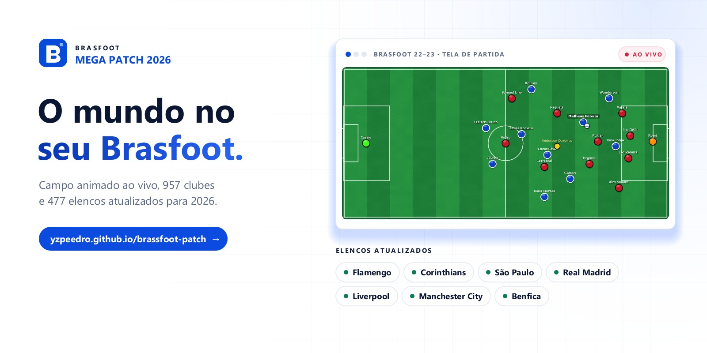
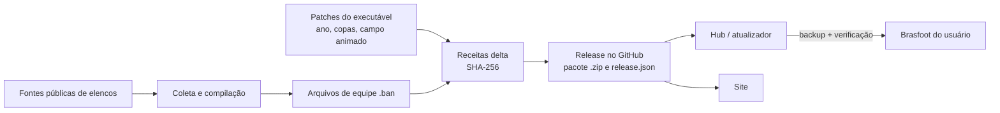

<p align="center">
  <a href="https://yzpeedro.github.io/brassfoot-patch/"></a>
</p>

<h1 align="center">Brasfoot Mega Patch</h1>

<p align="center">
  Atualizador gratuito e independente para uma instalação própria do Brasfoot 22-23.<br>
  Campo animado ao vivo, temporada 2026, elencos atualizados e um hub para cuidar do seu jogo.
</p>

<p align="center">
  <a href="https://yzpeedro.github.io/brassfoot-patch/"><strong>Site e download</strong></a> ·
  <a href="https://yzpeedro.github.io/brassfoot-patch/como-instalar/">Como instalar</a> ·
  <a href="https://github.com/yzPeedro/brassfoot-patch/releases/latest">Última versão</a> ·
  <a href="docs/README.md">Documentação</a>
</p>

---

## O que é

O Brasfoot Mega Patch atualiza uma instalação **existente e legítima** do Brasfoot 22-23. Ele não é um jogo novo, não inclui o jogo e não redistribui o executável original. Toda mudança é aplicada sobre os arquivos do próprio usuário, por receitas diferenciais verificadas por SHA-256, com backup antes de qualquer escrita.

| | |
|---|---|
| **Campo animado ao vivo** | Um campo 2D na tela de partida original com os 22 jogadores, a bola e o árbitro acompanhando cada lance. O motor de simulação do Brasfoot continua o mesmo: o campo é montado apenas com informações que o próprio jogo oferece durante a partida (lances, estatísticas, escalações, táticas e condição do gramado). |
| **Patch 2026** | 704 clubes, elencos atualizados no Brasil e na Europa, ano 2026 na carreira e as competições da temporada. |
| **Hub do Brasfoot** | Um único hub para Windows: baixe uma vez, escolha o que instalar, crie e restaure backups e abra o Brasfoot. Ele busca sozinho as versões novas do patch e do próprio hub e mostra o que mudou. |
| **Transparência** | Fontes registradas, cobertura publicada no site e nenhum dado esportivo inventado para preencher lacunas. |

## Download

Baixe o hub pelo [site](https://yzpeedro.github.io/brassfoot-patch/), que escolhe o pacote do seu sistema automaticamente, ou diretamente na página de [releases](https://github.com/yzPeedro/brassfoot-patch/releases/latest). Só é preciso baixar uma vez: o hub consulta a release mais recente a cada abertura, avisa quando há patch ou instalador novo e atualiza conferindo o SHA-256 de cada arquivo.

| Sistema | Pacote | Interface |
|---|---|---|
| Windows 10/11 (x64) | `Brasfoot-Mega-Patch-windows-x64.exe` | Hub gráfico (WebView2), com interface simples de reserva |
| Linux (x64, ARM64) | `Brasfoot-Mega-Patch-linux-*.tar.gz` | Linha de comando com seletor de pasta |
| macOS (Intel, Apple Silicon) | `Brasfoot-Mega-Patch-macos-*.tar.gz` | Linha de comando com seletor de pasta |

No Linux e no macOS o Brasfoot precisa de uma camada de compatibilidade (Wine ou CrossOver) configurada à parte. A execução nessas plataformas não é verificada pelo projeto.

## Como funciona



1. Os elencos são coletados de fontes públicas, conferidos e compilados nos arquivos de equipe do jogo.
2. As mudanças são empacotadas como **receitas delta**: cada arquivo resultante só é gerado a partir de um original com hash conhecido e é conferido por SHA-256 antes de ser escrito.
3. O hub baixa da release mais recente o pacote com as receitas, confere o SHA-256, detecta a instalação, mostra o que já está instalado, guarda um backup e aplica somente o que foi escolhido.
4. Cada release registra versão, commit de origem, hashes dos artefatos e o estado de verificação.

Detalhes em [Arquitetura](docs/architecture.md).

## Estrutura do repositório

| Caminho | Conteúdo |
|---|---|
| [`windows-installer/`](windows-installer/) | Hub e atualizadores em Go (Windows, Linux, macOS) |
| [`tools/`](tools/) | Coleta de dados, compilação, receitas, patches do executável, build e publicação |
| [`tools/live-match-view-src/`](tools/live-match-view-src/) | Código do campo animado ao vivo |
| [`site/`](site/) | Site estático publicado no GitHub Pages |
| [`config/`](config/) | Edição, fontes, mapeamentos de clubes e configurações de build |
| [`docs/`](docs/) | Documentação técnica |
| [`tests/`](tests/), [`site/tests/`](site/tests/) | Testes automatizados |

## Desenvolvimento

Requisitos: Go 1.23+, Python 3.12+, JDK 17+ (para os módulos Java) e Git.

```bash
git clone https://github.com/yzPeedro/brassfoot-patch.git
cd brassfoot-patch/windows-installer
go build ./...
```

Os guias completos estão em [docs/](docs/README.md):

- [Arquitetura](docs/architecture.md)
- [Módulos](docs/modules.md)
- [Pipeline de dados](docs/data-pipeline.md)
- [Hub e instalador](docs/installer.md)
- [Campo animado ao vivo](docs/live-match.md)
- [Site](docs/site.md)
- [Release e publicação](docs/release.md)

## Contribuindo

Contribuições são bem-vindas. Leia o [guia de contribuição](CONTRIBUTING.md) antes de abrir um pull request e a [política de segurança](SECURITY.md) para relatar vulnerabilidades.

## Aviso

Projeto independente e gratuito, feito pela comunidade. Brasfoot, nomes e marcas de clubes pertencem aos respectivos titulares. O Mega Patch não distribui o jogo nem seus binários; exige uma instalação própria do Brasfoot 22-23.
