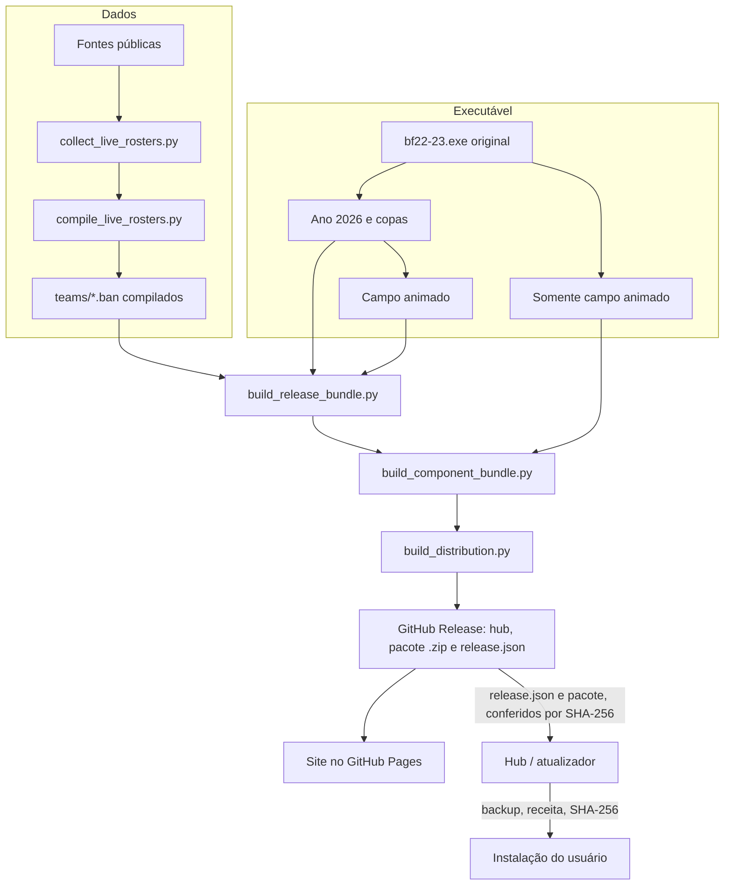

# Arquitetura

O Brasfoot Mega Patch é um conjunto de ferramentas que produz **receitas de atualização** para uma instalação existente do Brasfoot 22-23 e um **hub** que as aplica com segurança. Nenhum binário proprietário é distribuído.

## Visão geral

## Camadas

| Camada | Onde | Responsabilidade |
|---|---|---|
| Dados | `tools/collect_live_rosters.py`, `tools/compile_live_rosters.py`, `config/` | Coletar elencos de fontes públicas, aplicar a política de dados e gerar os arquivos de equipe |
| Executável | `tools/patch_*.py`, `tools/*-src/` | Ajustes reproduzíveis do executável: ano da carreira, Copa do Mundo, copas continentais e campo animado |
| Bundle | `tools/build_release_bundle.py`, `tools/build_component_bundle.py` | Transformar arquivos compilados em receitas delta, aceitar várias versões de origem e definir os componentes selecionáveis |
| Distribuição | `tools/build_distribution.py` | Compilar o hub e os atualizadores (sem patch embutido), gerar o pacote `.zip` da versão e o `release.json`, recursos do Windows e assinatura opcional |
| Publicação | `tools/publish_distribution.py`, `tools/publish_pages.py` | Criar a release, enviar e conferir artefatos, atualizar manifestos e site |
| Cliente | `windows-installer/` | Buscar a release mais recente, detectar a instalação, instalar componentes, gerenciar backups, atualizar o próprio hub e abrir o jogo |
| Site | `site/` | Download, catálogo de clubes, cobertura de dados e notas de versão |

## Receitas delta

Cada arquivo alterado é descrito por uma receita JSON em `bundled_release/patches/`. A pasta `windows-installer/bundled_release/` guarda o pacote da release atual no repositório; na publicação ele vira o arquivo `Brasfoot-Mega-Patch-<versão>-bundle.zip`, que o hub baixa (veja [Hub e instalador](installer.md#como-o-hub-obtém-a-versão-mais-recente)):

- **schema 1:** sequência de operações `copy` (intervalo do original) e `add` (bytes novos em base64), com SHA-256 e tamanho do original e do resultado;
- **schema 2:** lista de variantes schema 1, uma por versão de origem reconhecida;
- **schema 3:** cadeia de 2 a 8 receitas aplicadas em sequência, usada quando a origem é uma versão antiga.

O manifesto (`bundled_release/manifest.json`) lista cada arquivo com o hash final, os hashes de origem aceitos e a operação (`replace` ou `add`). O cliente recusa qualquer arquivo cujo hash atual não esteja na lista.

## Componentes

O manifesto declara a seção `components`. Desde o schema 2 (hub 1.1.0), o patch tem componentes independentes, que podem ser instalados e removidos em qualquer combinação (os escudos desde o hub 1.2.0):

| Componente | Arquivos | Como é removido |
|---|---|---|
| **Elencos 2026** (`rosters`) | `teams/*.ban` | cópias originais do próprio usuário (cofre de originais); arquivos que não existem no jogo original são apagados |
| **Temporada 2026** (`season`) | recursos do executável (ano 2026, Copa do Mundo de 48 seleções, copas continentais) e `conf_ligas_nacionais/BRA.cfg` quando o pacote o incluir | receita do executável |
| **Campo animado** (`live`) | recursos do executável | receita do executável |
| **Escudos atualizados** (`crests`) | `teams/escudos/*.png` (60×60) e `teams/escudosMini/*.png` (18×18) | escudo original guardado no cofre; escudo personalizado pelo usuário nunca é trocado nem removido |

O executável tem quatro variantes, todas reconhecidas por SHA-256 e com receita a partir das outras (`components.variants`):

| Temporada | Campo animado | Variante | Receita |
|---|---|---|---|
| sim | sim | `full` | `bf22-23.exe.json` |
| sim | não | `season` | `bf22-23.exe.patch.json` |
| não | sim | `live` | `bf22-23.exe.live.json` |
| não | não | `original` | `bf22-23.exe.original.json` |

Cada arquivo do manifesto traz o componente (`component`) e o hash do arquivo no jogo original (`vanillaSha256`, `vanillaSize` ou `vanillaMissing`), calculados por `build_component_bundle.py --original-game` a partir de uma instalação original. Os pacotes nunca contêm arquivos de equipe originais. Hubs 1.0.0 continuam instalando pelos campos antigos (`executables`), sem a remoção. Detalhes em [Hub e instalador](installer.md).

### Saves e compatibilidade

O patch não altera o formato dos saves: as classes serializadas pelo Brasfoot (o mundo `best.f` e as competições do pacote `f`) têm os mesmos campos no executável original e no do patch; o patch muda apenas métodos, como a montagem de competições novas. Por isso uma carreira salva abre e continua com ou sem o patch, nos dois sentidos, e o hub nunca grava em `sav/`. A verificação foi feita lendo e regravando uma cópia de save com os dois executáveis.

## Estados de verificação

Os manifestos públicos registram `tests=not-run-at-owner-request`, `compatibilityVerifiedInGame=false` e `gameplayVerified=false` enquanto não houver verificação em jogo. Compilação, geração de hashes e conferência de publicação garantem integridade, não compatibilidade funcional.
