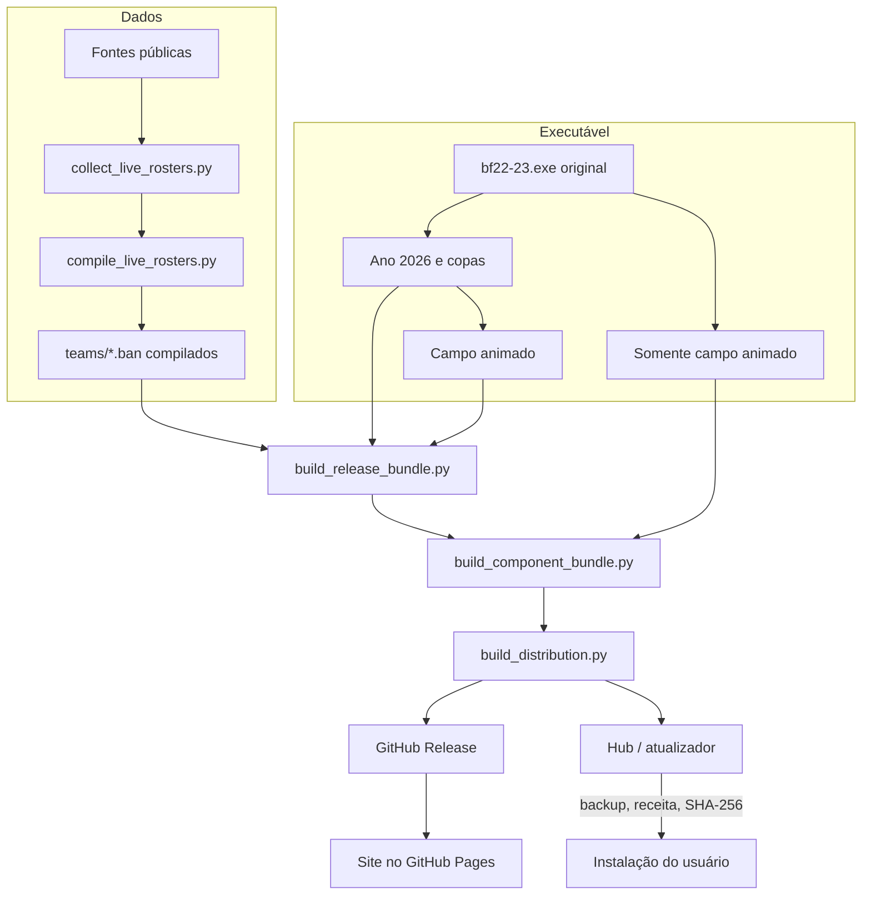

# Arquitetura

O Brasfoot Mega Patch é um conjunto de ferramentas que produz **receitas de atualização** para uma instalação existente do Brasfoot 22-23 e um **hub** que as aplica com segurança. Nenhum binário proprietário é distribuído.

## Visão geral

## Camadas

| Camada | Onde | Responsabilidade |
|---|---|---|
| Dados | `tools/collect_live_rosters.py`, `tools/compile_live_rosters.py`, `config/` | Coletar elencos de fontes públicas, aplicar a política de dados e gerar os arquivos de equipe |
| Executável | `tools/patch_*.py`, `tools/*-src/` | Ajustes reproduzíveis do executável: ano da carreira, Copa do Mundo, copas continentais e campo animado |
| Bundle | `tools/build_release_bundle.py`, `tools/build_component_bundle.py` | Transformar arquivos compilados em receitas delta, aceitar várias versões de origem e definir os componentes selecionáveis |
| Distribuição | `tools/build_distribution.py` | Compilar o hub e os atualizadores com o bundle embutido, recursos do Windows e assinatura opcional |
| Publicação | `tools/publish_distribution.py`, `tools/publish_pages.py` | Criar a release, enviar e conferir artefatos, atualizar manifestos e site |
| Cliente | `windows-installer/` | Detectar a instalação, instalar componentes, gerenciar backups e abrir o jogo |
| Site | `site/` | Download, catálogo de clubes, cobertura de dados e notas de versão |

## Receitas delta

Cada arquivo alterado é descrito por uma receita JSON em `bundled_release/patches/`:

- **schema 1:** sequência de operações `copy` (intervalo do original) e `add` (bytes novos em base64), com SHA-256 e tamanho do original e do resultado;
- **schema 2:** lista de variantes schema 1, uma por versão de origem reconhecida;
- **schema 3:** cadeia de 2 a 8 receitas aplicadas em sequência, usada quando a origem é uma versão antiga.

O manifesto (`bundled_release/manifest.json`) lista cada arquivo com o hash final, os hashes de origem aceitos e a operação (`replace` ou `add`). O cliente recusa qualquer arquivo cujo hash atual não esteja na lista.

## Componentes

A partir da 2026.5.1 o manifesto declara a seção `components`, que permite instalar o **Patch 2026**, o **campo animado** ou os dois:

| Seleção (somada ao que já está instalado) | Executável final | Receita |
|---|---|---|
| Patch 2026 + campo animado | patch completo com campo animado | `bf22-23.exe.json` |
| Somente Patch 2026 | patch 2026 sem o campo animado | `bf22-23.exe.patch.json` |
| Somente campo animado | original com o campo animado | `bf22-23.exe.live.json` |

Os arquivos de equipe e a configuração nacional pertencem ao Patch 2026. Componentes já instalados nunca são removidos por uma instalação; para voltar atrás, o usuário restaura um backup. Detalhes em [Hub e instalador](installer.md).

## Estados de verificação

Os manifestos públicos registram `tests=not-run-at-owner-request`, `compatibilityVerifiedInGame=false` e `gameplayVerified=false` enquanto não houver verificação em jogo. Compilação, geração de hashes e conferência de publicação garantem integridade, não compatibilidade funcional.
