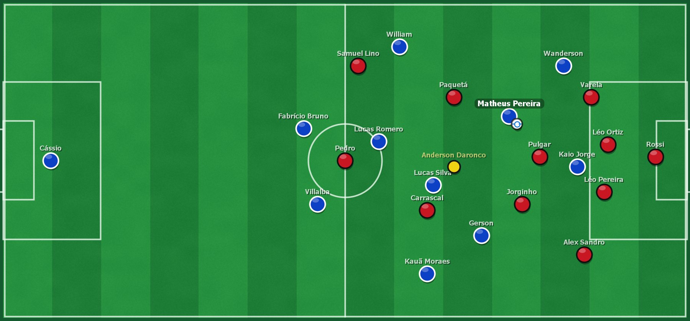

# Campo animado ao vivo

O campo animado desenha um campo 2D dentro da tela de partida original do Brasfoot, entre o placar e a tabela de outros jogos, com os 22 jogadores, a bola e o árbitro acompanhando os lances da partida assistida.

<p align="center"></p>

## Princípio: o motor do Brasfoot não muda

- O motor de simulação, as regras, os sorteios e os resultados continuam sendo os do Brasfoot.
- O painel apenas **lê** informações que o próprio jogo mantém durante a partida e as representa visualmente.
- Nenhum evento é criado pelo painel: gols, cartões, pênaltis, lesões e substituições só aparecem quando o Brasfoot os registra.

Informações do jogo usadas pelo painel:

| Informação | Uso no campo |
|---|---|
| Lances registrados da partida | Gols, gols contra, cartões, faltas com barreira, pênaltis, lesões, substituições e assistências |
| Estatísticas da partida | Finalizações, desarmes, erros de passe e faltas representados no momento em que entram nas estatísticas |
| Escalações em campo e posições | Formação, entradas, saídas e expulsões |
| Estilo, marcação e foco de ataque | Altura do bloco, pressão e preferência de jogadas |
| Condição do gramado | Textura e desgaste do campo |
| Placar, minuto, tempo e estado do relógio | Saída de bola, intervalo, fim de jogo e pausa |

## Integração com o jogo

O patch é aplicado por [`tools/patch_live_match_view.py`](../tools/patch_live_match_view.py), que compila os fontes de [`tools/live-match-view-src/`](../tools/live-match-view-src/) e altera somente a classe da tela de partida (`a/dV.class`) dentro do executável, além de adicionar as classes do pacote `mega`:

| Ponto de integração | O que acontece |
|---|---|
| Construtor da tela de partida | Instala o painel (`mega.LiveMatchPanel.install`) e abre um espaço próprio no layout original, sem cobrir controles do jogo |
| Passo do minuto | A chamada ao passo de simulação do minuto passa por `LiveMatchPanel.engineStep`. O painel executa o mesmo método do jogo no início do minuto, uma única vez, para conhecer os lances antes de exibi-los; o temporizador do jogo pula o passo já executado |
| Cobrança de pênalti | `LiveMatchPanel.beforePenaltyKick` anima a preparação da cobrança; o resultado continua sendo decidido pela tela original de pênalti |

O transformador ([`LiveMatchTransformer.java`](../tools/live-match-view-src/LiveMatchTransformer.java)) usa ASM e confere o SHA-256 da classe original antes de alterar qualquer coisa. O patch aceita dois executáveis de origem:

| Origem | Resultado |
|---|---|
| Executável original do Brasfoot 22-23 | Somente o campo animado |
| Executável do Patch 2026 | Patch 2026 com o campo animado |

```bash
python tools/patch_live_match_view.py --source <bf22-23.exe> --output <pasta>/bf22-23.exe
```

## Garantias de execução

- **Nunca travar o jogo:** qualquer erro no quadro do painel zera as animações e devolve o relógio ao Brasfoot; cada fase tem prazo máximo, e o relógio nunca fica retido por mais de alguns segundos.
- **Pausa e substituições:** pedidos de pausa e substituição são atendidos no tempo original do jogo.
- **Bola sempre ancorada:** a posse só muda por contato (passe, domínio, desarme ou cobrança), e cada fase termina em um estado explícito.
- **Diagnóstico:** eventos de integração são registrados em `%LOCALAPPDATA%\BrassfootPatch2026\live-match-debug.log`.

## Imagens

As imagens do site e da documentação são renderizadas pelo próprio código do painel, com elencos do patch, por [`tools/render_live_match_preview.py`](../tools/render_live_match_preview.py):

```bash
python tools/render_live_match_preview.py
python tools/render_live_match_preview.py --output <pasta> --scale 1 --condition 0
```

São geradas quatro imagens, uma para cada condição de gramado (excelente, muito boa, ruim e precária).

## Desenvolvimento

1. Altere os fontes em `tools/live-match-view-src/`.
2. Gere o executável com `patch_live_match_view.py` a partir de uma cópia do executável de origem em `data/private/`.
3. Gere o bundle de componentes com [`tools/build_component_bundle.py`](../tools/build_component_bundle.py) e o instalador com [`tools/build_distribution.py`](../tools/build_distribution.py) usando uma edição de prévia (`channel: local-preview`).
4. Distribua prévias apenas localmente até a release.

Ao mexer na movimentação ou nos eventos, preserve as regras de sincronização: transições de posse por contato, eventos durante paralisações enfileirados, placar do painel atualizado somente quando a bola entra e toda fase nova com condição de saída e prazo de segurança.
